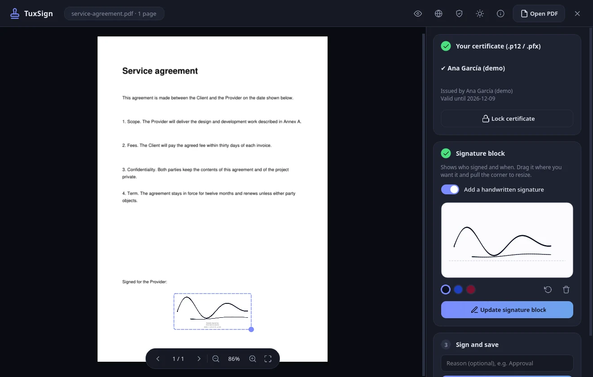

<div align="center">

# TuxSign

**Sign your PDFs with your digital certificate without anything leaving your computer.**

[](https://github.com/gugeldot/TuxSign/actions/workflows/ci.yml)

[Website](https://gugeldot.github.io/TuxSign/) · [Releases](https://github.com/gugeldot/TuxSign/releases) · [Español](README.md)



</div>

TuxSign is a free Linux app that signs PDF documents with your `.p12` certificate (PAdES). It started from a simple idea: signing a document shouldn't mean uploading it to a website or running a program that phones home. Everything here happens on your computer, with no cloud, no network and no telemetry.

## What it does

- Opens a PDF with zoom, page navigation and drag and drop.
- Signs with your `.p12` or `.pfx` certificate. It is a PAdES signature with SHA-256 that covers the whole document.
- Places a "Digitally signed by" block with the date. Move it anywhere and resize it.
- Optionally adds your handwritten signature, drawn with a mouse, trackpad or pen. It is off by default.
- Signs the same document several times and checks the integrity of the signatures it already has.
- Light and dark themes, in English, Spanish, French, German and Portuguese.

## Install

### With Flatpak (recommended)

Download the `.flatpak` bundle from [Releases](https://github.com/gugeldot/TuxSign/releases) and run:

```bash
flatpak install --user ./tuxsign-1.2.0.flatpak
flatpak run io.github.tuxsign.TuxSign
```

The Flatpak runs sandboxed: it has no network and only sees the files you pick in the file chooser.

### From source

You need Linux with Wayland or X11 and Python 3.10 or newer.

```bash
git clone https://github.com/gugeldot/TuxSign.git
cd TuxSign
./build.sh run
```

## How to use it

1. Open a PDF, or drop it on the window.
2. Choose your `.p12` certificate, type the password and click Unlock.
3. Click "Place signature block". For a handwritten signature, turn on the switch and draw it.
4. Drag the block where you want it and pull the corner to resize it.
5. Click "Sign document". A new copy is saved and the original is never touched.

If you leave the app idle for five minutes it locks the certificate by itself.

## Privacy and security

- **No network.** A system filter (seccomp and Landlock) stops it from opening connections, and the Flatpak has no network at all.
- **The PDF is opened in a separate process.** The code that reads the document can't see your certificate, touch files or launch programs.
- **It checks its own code** at startup with a digital signature. If someone modifies it, it won't start.
- **It keeps very little.** An optional log of dates and events, with no names or paths, that you can export or delete at any time.

The full details, including what TuxSign does not do, are in [docs/seguridad.md](docs/seguridad.md) (in Spanish). To report a vulnerability, follow [SECURITY.md](SECURITY.md).

## Limitations

- The signature is PAdES-B-B. It has no timestamp or long-term validation data, because that would need Internet access. The date in the block is your computer's clock.
- The legal value of a signature depends on your certificate and your country's rules. TuxSign is not a certified tool.
- The certificate password goes through Python memory, which can't be reliably wiped. The less time the certificate stays unlocked, the better.
- Encrypted PDFs are not supported.

## Build packages

Everything goes through `build.sh`: `run`, `test`, `audit`, `checksec`, `bump`, `wheel`, `native` and `flatpak`. Run `./build.sh` with no arguments to see the list. For the Flatpak you need `flatpak-builder`, which you can install without root with `flatpak install --user flathub org.flatpak.Builder`.

Release builds are signed with your own key. Create it with `python scripts/release.py keygen`, keep it outside the repository and back it up.

## Contributing

Ideas, bug reports and patches are welcome. Please read [CONTRIBUTING.md](CONTRIBUTING.md) first (in Spanish for now).

## Licenses

TuxSign's code is [MIT](LICENSE). Binary packages bundle other libraries under their own licenses, including PyMuPDF (AGPL-3.0), PySide6 and Qt (LGPL-3.0), pyHanko (MIT), cryptography (Apache-2.0 or BSD) and Pillow (HPND). If you redistribute those packages you must comply with them too. For PyMuPDF that means offering the corresponding source code.
