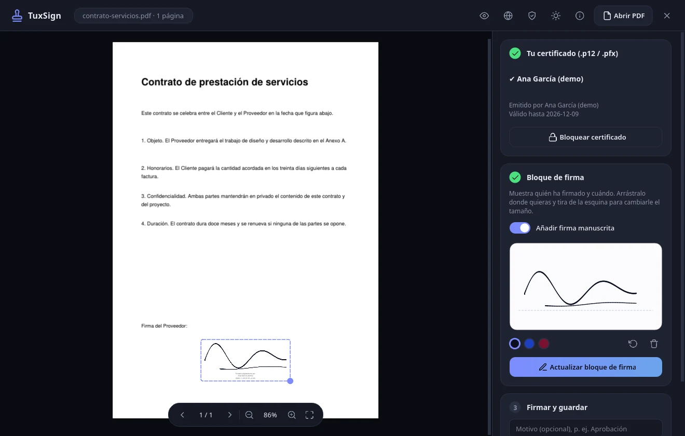

<div align="center">

# TuxSign

**Firma tus PDF con tu certificado digital sin que nada salga de tu ordenador.**

[](https://github.com/gugeldot/TuxSign/actions/workflows/ci.yml)

[Web](https://gugeldot.github.io/TuxSign/) · [Descargas](https://github.com/gugeldot/TuxSign/releases) · [English](README.en.md)



</div>

TuxSign es una aplicación libre para Linux que firma documentos PDF con tu certificado `.p12` (PAdES). Nació de una idea simple: firmar un documento no debería obligarte a subirlo a ninguna web ni a instalar un programa que llama a casa. Aquí todo ocurre en tu equipo, sin nube, sin red y sin telemetría.

## Qué puedes hacer con ella

- Abrir un PDF y verlo con zoom, navegación por páginas y arrastrando el archivo a la ventana.
- Firmar con tu certificado `.p12` o `.pfx`. La firma es una firma PAdES con SHA-256 y cubre todo el documento.
- Colocar un bloque con el texto "Firmado digitalmente por" y la fecha, moverlo donde quieras y cambiarle el tamaño.
- Añadir, si quieres, tu firma manuscrita dibujada con el ratón, el trackpad o un lápiz. Viene desactivada por defecto.
- Firmar varias veces el mismo documento y comprobar la integridad de las firmas que ya tiene.
- Cambiar entre tema claro y oscuro, y entre inglés, español, francés, alemán y portugués.

## Instalación

### Con Flatpak (lo recomendado)

Descarga el paquete `.flatpak` desde [Descargas](https://github.com/gugeldot/TuxSign/releases) y ejecuta:

```bash
flatpak install --user ./tuxsign-1.2.0.flatpak
flatpak run io.github.tuxsign.TuxSign
```

El Flatpak corre en un entorno aislado: no tiene red y solo ve los archivos que tú eliges en el selector.

### Desde el código fuente

Necesitas Linux con Wayland o X11 y Python 3.10 o superior.

```bash
git clone https://github.com/gugeldot/TuxSign.git
cd TuxSign
./build.sh run
```

El script crea un entorno virtual, instala las dependencias fijadas y abre la aplicación.

## Cómo se usa

1. Abre un PDF, o suéltalo sobre la ventana.
2. Elige tu certificado `.p12`, escribe la contraseña y pulsa Desbloquear.
3. Pulsa "Colocar bloque de firma". Si quieres tu firma manuscrita, activa el interruptor y dibújala.
4. Arrastra el bloque a su sitio y tira de la esquina para ajustar el tamaño.
5. Pulsa "Firmar documento". Se guarda una copia nueva y el original no se toca nunca.

Si dejas la aplicación quieta cinco minutos, bloquea el certificado sola.

## Privacidad y seguridad

TuxSign está pensada para que puedas fiarte de ella sin tener que fiarte a ciegas.

- **No usa la red.** Un filtro del sistema (seccomp y Landlock) le impide crear conexiones, y el Flatpak además la deja sin red.
- **El PDF se abre en un proceso aparte.** Lo que lee el documento no puede ver tu certificado, tocar archivos ni lanzar programas.
- **Comprueba su propio código** al arrancar con una firma digital. Si alguien lo modifica, no arranca.
- **Guarda lo mínimo.** Un registro opcional con fechas y eventos, sin nombres ni rutas, que puedes exportar o borrar entero cuando quieras.

Los detalles, incluido lo que TuxSign no hace, están en [docs/seguridad.md](docs/seguridad.md). Si encuentras una vulnerabilidad, cuéntalo como explica [SECURITY.md](SECURITY.md).

## Limitaciones

Es mejor que lo sepas antes de usarla:

- La firma es PAdES-B-B. No lleva sello de tiempo ni información para validación a largo plazo, porque eso exigiría conectarse a Internet. La fecha del bloque es la del reloj de tu equipo.
- El valor legal de una firma depende de tu certificado y de la normativa de tu país. TuxSign no es una herramienta certificada.
- La contraseña del certificado pasa por la memoria de Python, que no se puede borrar de forma fiable. Cuanto menos tiempo esté desbloqueado el certificado, mejor.
- No admite PDF cifrados.

## Compilar paquetes

Todo se hace con `build.sh`:

| Comando | Qué hace |
|---|---|
| `./build.sh run` | Ejecuta la aplicación desde el código fuente |
| `./build.sh test` | Pasa los tests y una prueba de la interfaz |
| `./build.sh audit` | Busca vulnerabilidades conocidas en las dependencias y problemas en el código |
| `./build.sh checksec` | Revisa las protecciones de memoria de los binarios |
| `./build.sh bump patch` | Sube la versión (`major`, `minor` o `patch`) |
| `./build.sh wheel` | Genera un paquete Python con integridad firmada |
| `./build.sh native` | Compila el código a binario nativo, sin archivos `.py` (necesita Python 3.12 o 3.13) |
| `./build.sh flatpak` | Genera el paquete `.flatpak` |

Para el Flatpak hace falta `flatpak-builder`. Sin permisos de administrador lo puedes instalar con `flatpak install --user flathub org.flatpak.Builder`, y `build.sh` lo detecta solo. Si prefieres el paquete de tu distribución, en Arch es `sudo pacman -S flatpak-builder`.

Las builds de release se firman con una clave tuya. Créala con `python scripts/release.py keygen`, guárdala fuera del repositorio y haz copia de seguridad.

## Contribuir

Las ideas, los avisos de fallos y los parches son bienvenidos. Antes de abrir un PR, echa un vistazo a [CONTRIBUTING.md](CONTRIBUTING.md).

## Licencias

El código de TuxSign es [MIT](LICENSE). Los paquetes con binarios incluyen otras librerías con sus propias licencias, entre ellas PyMuPDF (AGPL-3.0), PySide6 y Qt (LGPL-3.0), pyHanko (MIT), cryptography (Apache-2.0 o BSD) y Pillow (HPND). Si redistribuyes esos paquetes, tienes que cumplir también con ellas. En el caso de PyMuPDF eso significa ofrecer el código fuente correspondiente.

Gracias a los proyectos que lo hacen posible: [pyHanko](https://github.com/MatthiasValvekens/pyHanko), [PyMuPDF](https://github.com/pymupdf/PyMuPDF), [Qt para Python](https://doc.qt.io/qtforpython-6/), [cryptography](https://github.com/pyca/cryptography) y [Nuitka](https://nuitka.net/).
